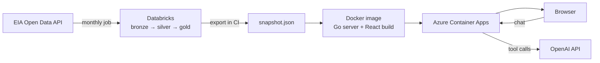

# U.S. Electricity Mix

An interactive dashboard showing how the United States has generated its electricity, month by month, from 2001 through the U.S. Energy Information Administration's (EIA) latest forecast, with an AI assistant that answers questions about the data.

**Live site:** https://energy-tracker.kindwater-d700c767.centralus.azurecontainerapps.io

## Features

- **Monthly energy mix.** A pie chart and legend show each source's share of generation (coal, natural gas, nuclear, hydro, wind, solar, petroleum, and other) for the selected month, with the year-over-year change in share and summary totals for fossil fuels, renewables, and nuclear.
- **Timeline playback.** Scrub through every month since January 2001 with a slider, step a month at a time, or press play to animate two decades of change.
- **Trends over time.** A stacked chart of every source's share (monthly or 12-month average) or generation in terawatt-hours. Click anywhere on the chart to jump to that month.
- **Milestones.** Detected automatically from the data: the month one source's 12-month average share overtook another's and stayed ahead for at least a year, such as natural gas passing coal.
- **EIA forecast.** Months beyond the latest actual data come from EIA's Short-Term Energy Outlook (STEO), shown shaded on the timeline and dashed on the trends chart.
- **AI assistant.** An "Ask AI" chat answers questions about the data, including investment-oriented ones, by looking up the actual figures rather than relying on the model's memory. It knows which month you're viewing, streams its answers, and shows which data it consulted. Answers are educational only, not financial advice.

## Tech stack

| Layer | Technologies |
| --- | --- |
| Frontend | React 19, TypeScript, Vite, Chart.js (react-chartjs-2), react-markdown, Oxlint |
| Backend | Go (standard library `net/http`), Databricks SQL driver |
| Data pipeline | Databricks (Python notebooks, Spark SQL, Unity Catalog, Asset Bundles) |
| AI | OpenAI Responses API with function calling, streamed over server-sent events |
| Hosting | Docker, Azure Container Apps, GitHub Container Registry |
| CI/CD | GitHub Actions with OpenID Connect sign-in to Azure |
| Data source | [EIA Open Data API](https://www.eia.gov/opendata/) (electricity generation and STEO) |

## How it works



### Data pipeline (Databricks)

A Databricks job (`databricks/`), deployed as an Asset Bundle, runs on the 20th of each month after EIA publishes new figures. It follows a medallion layout:

| Stage | Tables | What happens |
| --- | --- | --- |
| Bronze | `bronze_eia_generation`, `bronze_steo_generation` | Raw API responses. Recent months are re-pulled each run because EIA revises them. Each STEO release is kept under the month it was retrieved, building a history of forecasts. |
| Silver | `silver_generation_by_fuel`, `silver_steo_generation` | Typed, cleaned generation per month and source. |
| Gold | `gold_energy_mix_monthly`, `gold_energy_trends`, `gold_energy_milestones`, `gold_energy_forecast` | Shares of total, 12-month rolling shares, year-over-year changes, detected milestones, and the newest forecast for months after the latest actuals. |

Rolling averages and year-over-year changes are computed across actual and forecast months together, so the lines continue smoothly into the forecast.

### API server (Go)

The server in `server/` serves the JSON API and, in production, the built frontend. It reads data through a small interface with three interchangeable backends, chosen by `DATA_SOURCE`:

- `eia`: calls the EIA API live (energy mix only, with an in-memory cache).
- `databricks`: queries the gold tables through a Databricks SQL warehouse.
- `snapshot`: reads a JSON export of the gold tables. Production uses this, so the live site needs no Databricks credentials and never waits on a warehouse to start.

| Endpoint | Returns |
| --- | --- |
| `GET /api/energy/real/{YYYY-MM}` | The mix for one month |
| `GET /api/energy/range?start=&end=` | The mix for a range of months |
| `GET /api/energy/trends?start=&end=` | Generation, shares, rolling shares, and year-over-year changes |
| `GET /api/energy/milestones` | Detected milestones |
| `GET /api/energy/forecast` | The latest EIA forecast |
| `GET /api/chat/status` | Whether the assistant is enabled |
| `POST /api/chat` | A streamed assistant reply |
| `GET /healthz` | Health check |

### AI assistant

The assistant is an agent built on the OpenAI Responses API. Instead of putting the whole dataset in the prompt, the model is given four tools backed by the same data as the dashboard:

- `get_monthly_data`: shares and generation for chosen months and sources
- `get_annual_summary`: yearly totals and shares
- `get_eia_forecast`: EIA's projections, including annual totals
- `get_milestones`: the detected crossovers

The server runs the loop: it streams the model's text to the browser as server-sent events, executes any tool calls the model makes, and sends the results back until the model finishes. Its instructions require every number to come from a tool result, spell out what the data doesn't cover (such as prices, capacity, and state-level data), and set investment guardrails: it can discuss what generation trends suggest for sectors and themes, but won't recommend specific securities, give price targets, or give personalized advice.

Safeguards keep a public deployment from running up costs: a per-visitor rate limit of 10 requests per minute, caps on conversation length and message size, a limit on output length and tool-call rounds, and a 2-minute timeout per reply.

### Deployment

Pushing to `main` runs the GitHub Actions workflow in `.github/workflows/deploy.yml`:

1. **Test:** lint and build the frontend; `go vet` and `go test` the server.
2. **Snapshot:** export the Databricks gold tables to `snapshot.json`.
3. **Build:** a multi-stage Docker build compiles the React app and the Go server into a roughly 25 MB distroless image, pushed to GitHub Container Registry.
4. **Deploy:** sign in to Azure with OpenID Connect (no stored Azure passwords) and roll the Container App to the new image.

The workflow also runs on the 21st of each month, the day after the Databricks job, so the live site picks up new data automatically. The Container App scales to zero when idle, which keeps hosting within Azure's free monthly allowance. The OpenAI key is stored as a Container App secret, not in the repository or image.

## Running locally

**Prerequisites:** Node.js 24+, Go 1.27+, and a free [EIA API key](https://www.eia.gov/opendata/register.php).

1. Configure the server:

   ```sh
   cp server/.env.example server/.env
   ```

   Then edit `server/.env`. With only `EIA_API_KEY` set, the dashboard shows the monthly mix from the live EIA API. Trends, milestones, the forecast, and the assistant need `DATA_SOURCE=databricks` (with the Databricks settings) or `DATA_SOURCE=snapshot`, and the assistant also needs `OPENAI_API_KEY`.

2. Start the API server (port 8080):

   ```sh
   cd server
   go run .
   ```

3. In another terminal, start the frontend (Vite proxies `/api` to the server):

   ```sh
   npm install
   npm run dev
   ```

To create a snapshot from Databricks and run the production image locally:

```sh
cd server
go run . export-snapshot ../snapshot.json
cd ..
docker build -t energy-tracker .
docker run -p 8080:8080 -e OPENAI_API_KEY=... energy-tracker
```

### Tests

```sh
npm run lint
npm run build
cd server && go vet ./... && go test ./...
```

## Project structure

```text
├── src/                  React frontend
│   ├── App.tsx           Dashboard: pie chart, stats, timeline
│   ├── TrendsChart.tsx   Trends chart and milestones
│   ├── ChatPanel.tsx     AI assistant panel
│   └── services/         API clients
├── server/               Go API server
│   ├── handlers.go       HTTP routes
│   ├── eia.go, databricks.go, snapshot.go   Data sources
│   ├── chat.go           Assistant: streaming and the tool loop
│   ├── chat_tools.go     Tools the model can call
│   └── openai.go         OpenAI Responses API client
├── databricks/           Databricks Asset Bundle: ETL job and notebooks
├── Dockerfile            Production image
└── .github/workflows/    CI/CD pipeline
```

## Data notes

Figures cover the U.S. electric power sector (utilities and independent power producers) and exclude small-scale rooftop solar. Recent months are revised by EIA after first publication. Forecasts are EIA's Short-Term Energy Outlook, not this project's own predictions.
